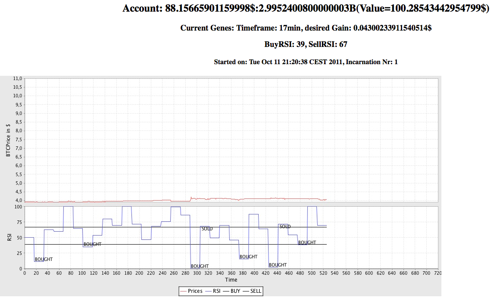

+++
title = "Evolving Bitcoin Trade Bot"
date = 2012-11-28T21:02:00Z
path = "blog/2012/11/28/evolving-bitcoin-trade-bot"

[taxonomies]
categories = ["bitcoin", "algo trading", "java", "genetic algorithms"]
+++

<a href="https://github.com/jonasnick/bagalute">Bagalute</a> is a trade bot, designed for buying a currency (bitcoin) at the the right time. As a decision criterium it uses the relative strength index (RSI). The bot looks at the price development of the last twelve hours and runs an evolutionary algorithm to determine the optimal parameters for the RSI in that time frame. Then, it uses these parameters for the next time frame. Currently the bot uses for debugging purposes a dummy interface to trade. The actual success of the bot was sparsely tested but had negative results, maybe due to a general downtrend of prices.
I wrote it during my 2nd semester break
