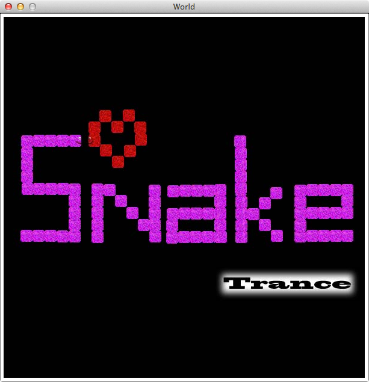

+++
title = "Snake in Racket"
date = 2012-11-28T19:28:00Z
path = "blog/2012/11/28/snake-in-racket"

[taxonomies]
categories = ["racket", "snake"]
+++
  
Snake implementation
<a href="https://github.com/jonasnick/snake">Snake</a> 
 in the functional language Racket with GUI. Homework of the first semester of computer science.
The music of the game is generated by the player's movements and his success.
