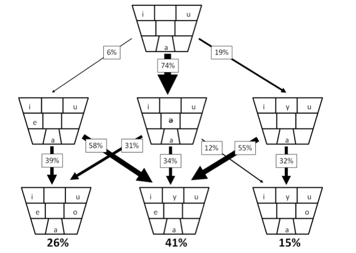

+++
title = "Signaling Games and Language"
date = 2012-11-29T00:15:00Z
path = "blog/2012/11/29/signaling-games-and-language"

[taxonomies]
categories = ["signaling games", "python", "evolution", "pragmatics"]
+++
  
Two papers I wrote with <a href="http://www.sfs.uni-tuebingen.de/~roland/index.html">Roland Mühlenbernd</a> last winter. We mainly explored what happens when the players are able to invent new messages in <a href="http://en.wikipedia.org/wiki/Signaling_game">signaling games</a>. 
The important finding in the <a href="/papers/ForceOfInnovation.pdf">first paper</a> is that the players ability to make up new messages overcomes signaling bottlenecks and leads to successfull communication even if the number of strategies is high. When coupled with a reasonable mechanism for message extinction, the agents will play perfect strategies in the end. 
The <a href="/papers/Innovation_Evolution.pdf">second paper</a> explores the evolution of the vowel space with this technique. The resulting partitions of the vowel space resemble these of actual languages.   
